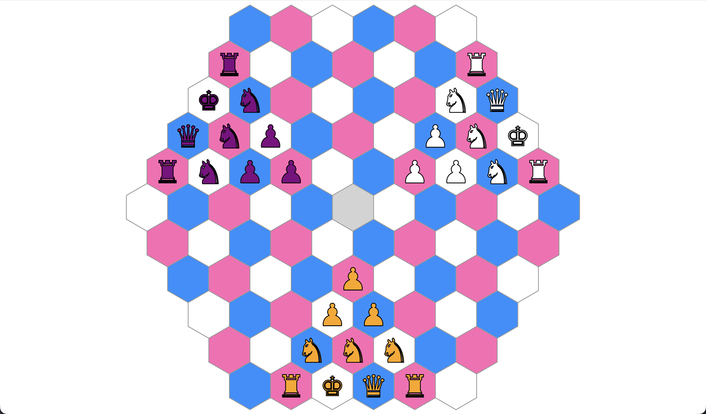

# Starwell 
An implementation of Stefan Gruber's [Starwell](https://www.artstation.com/artwork/393GEE), a three-player hex-chess.



## Install

This projects uses `bun` to compile, bundle and run the JavaScript. Follow these docs to (install bun)[https://bun.com/docs/installation].

```
git clone https://github.com/geluso/stefan-grubers-starwell
cd stefen-grubers-starwell
bun index.html
```

Visit <http:localhost:3000>

## Deploy to a static website

Run these commands from the project directory.

```sh
bun install
bun run build
```

Upload the contents of `dist/` to your website. The generated `index.html` loads bundled JavaScript, CSS, and image assets from that directory. Run the build again before deploying future updates.


## Online play

Starwell uses Supabase for email sign-in, display names, invite-only rooms, and game history. DreamHost serves the frontend at `https://5tephen.com/starwell/`. Each room opens when all three seats are filled. The server checks turn order and move legality before saving each turn. Players can reload their invite link to resume.

### Run locally

With Docker running, use the Supabase CLI to apply the migration and start the local services.

```sh
bun install
bun run build:edge
npx supabase start
```

Use the local API URL and publishable key from `npx supabase status` to build the frontend.

```sh
STARWELL_PUBLIC_SUPABASE_URL=http://127.0.0.1:54321 \
STARWELL_PUBLIC_SUPABASE_PUBLISHABLE_KEY=your-local-publishable-key \
bun run build
python3 -m http.server 3000 --directory dist
```

Open `http://localhost:3000/` and select **New Game → Create Online Game**. Open the Mailpit URL shown by `npx supabase status` to retrieve local sign-in emails. Use three separate browser profiles to test an invite.

Run the existing tests with `bun test`. To check the local multiplayer stack, run this in Bash or Zsh after starting Supabase.

```sh
set -a
source <(npx supabase status -o env 2>/dev/null | rg '^(PUBLISHABLE_KEY|SECRET_KEY|ANON_KEY|SERVICE_ROLE_KEY)=')
set +a
bun scripts/check-online.ts
```

### Deploy to DreamHost and Supabase

1. In the hosted Supabase project, enable email sign-in and set the Auth Site URL to `https://5tephen.com/starwell/`. Add that URL to the redirect allowlist, including the invite URL pattern `https://5tephen.com/starwell/**` for sign-in links that carry a room ID. Configure custom SMTP so Supabase can send magic links to players.
2. Apply the database migration and deploy the Edge Function from the repository.

   ```sh
   npx supabase login
   npx supabase link --project-ref your-project-ref
   npx supabase db push --remote
   bun run build:edge
   npx supabase functions deploy starwell --no-verify-jwt --use-api
   ```

3. Run `bun run build` for the Starwell Supabase project. For a different project, override both the API URL and its **publishable key**. The Edge Function reads its privileged key from Supabase at runtime.

   ```sh
   STARWELL_PUBLIC_SUPABASE_URL=https://your-project-ref.supabase.co \
   STARWELL_PUBLIC_SUPABASE_PUBLISHABLE_KEY=your-publishable-key \
   bun run build
   ```

4. Upload the new assets and then `dist/index.html` to the existing DreamHost `/starwell/` directory. Open the public page and confirm you can receive a sign-in email and start a game with two invitees.
